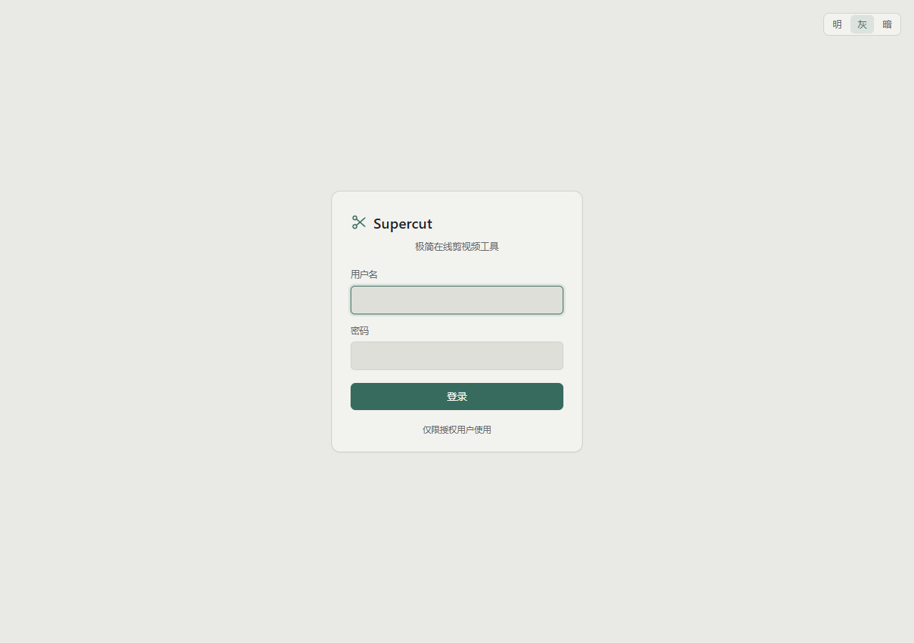
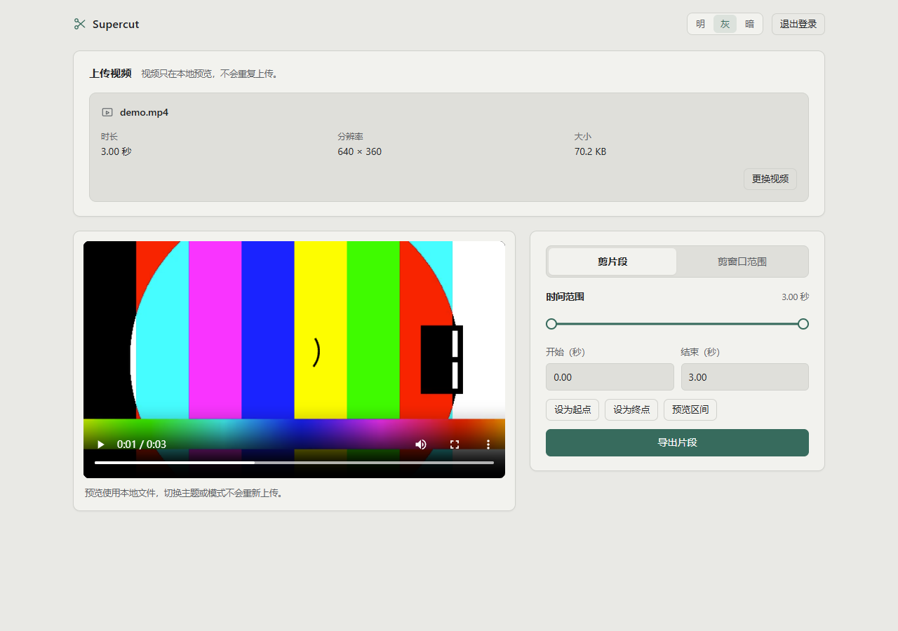
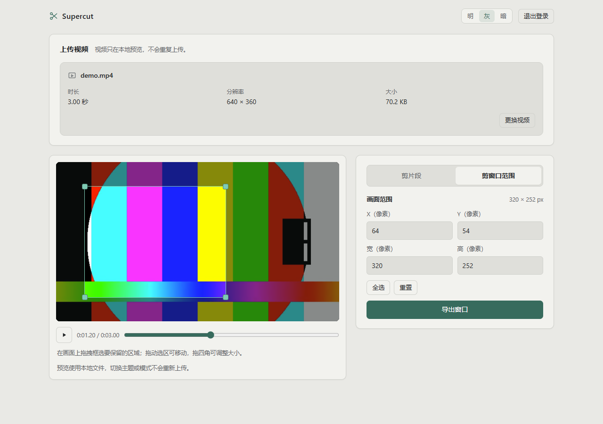
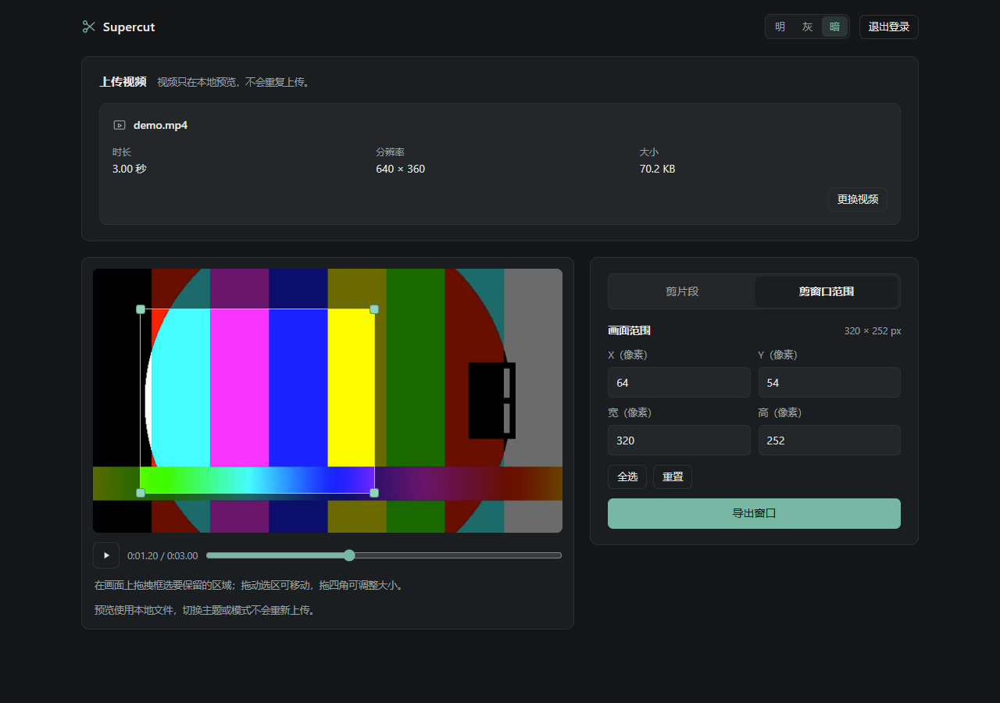

# Supercut · 极简在线剪视频工具

一个开箱即用的微型在线剪辑工具，只做两件事：

- **剪片段**：选择起止时间，把中间一段单独导出（如只保留精彩片段）。
- **剪窗口范围**：在画面上框选一个区域，把该画面区域裁剪出来（如去掉黑边、改画幅）。

技术栈极简：Python（Flask）+ 原生 HTML/CSS/JS + FFmpeg，无前端构建、无数据库、无第三方云服务。
界面支持 **明 / 灰 / 暗** 三套主题切换；访问需账号密码登录。

**在线使用**：<https://wkeeli.cn/supercut/>（需向部署者获取账号密码）

## 界面



| 剪片段 | 剪窗口范围 |
|---|---|
|  |  |

暗色主题下的框选界面：



## 功能

| 功能 | 输入 | 输出 |
|---|---|---|
| 剪片段 | 视频 + 开始/结束时间（秒） | 该时间区间的 MP4 |
| 剪窗口范围 | 视频 + 画面矩形 `(x, y, 宽, 高)` | 裁剪后画面区域的 MP4 |

- 视频在浏览器本地预览，只有原始文件会上传一次；导出文件在服务端临时保存（默认 2 小时后自动清理）。
- 导出统一转 H.264 / AAC MP4，兼容主流播放器。

## 本地运行

前置：Python 3.10+；FFmpeg（Windows 本机没有时可用 `pip install imageio-ffmpeg` 自动探测，Linux 用 `apt install ffmpeg`）。

```powershell
pip install -r requirements-dev.txt
powershell -ExecutionPolicy Bypass -File .\run_local.ps1
```

打开 http://127.0.0.1:8080 ，用户名 `admin`，密码 `supercut-dev`（仅本地）。

手动启动（自定义账号密码）：

```powershell
$env:SUPERSCUT_PASSWORD="你的密码"
$env:SUPERSCUT_SECRET_KEY="随机长字符串"
python app.py
```

环境变量说明见 [docs/CONTRACT.md](docs/CONTRACT.md#3-运行方式约定)。

## 测试

```powershell
python -m pytest -q
```

测试使用 FFmpeg 现场生成 1~2 秒测试视频，离线可跑。

## 部署（Linux + Caddy 子路径）

生产形态：`gunicorn` 跑 Flask（仅监听 `127.0.0.1`）+ Caddy 反向代理到 `https://wkeeli.cn/supercut/`，账号密码在应用内校验。

```bash
# 服务器（Ubuntu 24.04）
sudo apt install -y ffmpeg python3-venv
sudo mkdir -p /opt/supercut /var/lib/supercut
# 同步代码后用 venv 安装依赖，systemd 托管：
#   ExecStart=/opt/supercut/venv/bin/gunicorn app:app --workers 1 --threads 4 \
#       --timeout 1200 --bind 127.0.0.1:8070
```

Caddyfile 片段（放在 `wkeeli.cn { ... }` 内、兜底 `reverse_proxy localhost:5000` 之前）：

```caddy
redir /supercut /supercut/ 308
handle_path /supercut/* {
    reverse_proxy 127.0.0.1:18070 {
        header_up X-Forwarded-Prefix /supercut
    }
}
```

> 说明：`18070` 是开发机经 frp 隧道暴露到反代机的端口；若反代机可直连开发机，可改为 `http://<dev-host>:8070`。
> 必须开启 `SUPERSCUT_BEHIND_PROXY=1`、`SUPERSCUT_COOKIE_SECURE=1` 且设置固定的 `SUPERSCUT_SECRET_KEY`。

## 目录结构

```
app.py                  Flask 应用（页面 + API + FFmpeg 调用 + 登录鉴权）
templates/              login.html / index.html
static/                 style.css / app.js（登录页与主页面共用主题样式）
tests/                  pytest（生成测试视频，覆盖鉴权 / 探测 / 剪片段 / 裁剪）
docs/CONTRACT.md        前后端 API 契约（开发用）
run_local.ps1           Windows 本地一键启动
requirements.txt        生产依赖：Flask + gunicorn
requirements-dev.txt    开发依赖：pytest + imageio-ffmpeg
```

## 安全说明

- 密码只通过环境变量注入（systemd `Environment=`），不写入代码或 Git；未配置密码应用拒绝启动。
- 上传文件只以随机 UUID 命名保存，不使用用户文件名拼接路径；导出/下载同样用随机 token。
- session 使用 `HttpOnly` + `SameSite=Lax` cookie；HTTPS 下开启 `Secure`。
- 临时文件默认 2 小时自动清理。

## License

MIT
